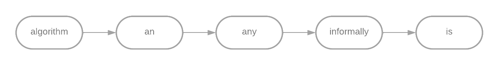
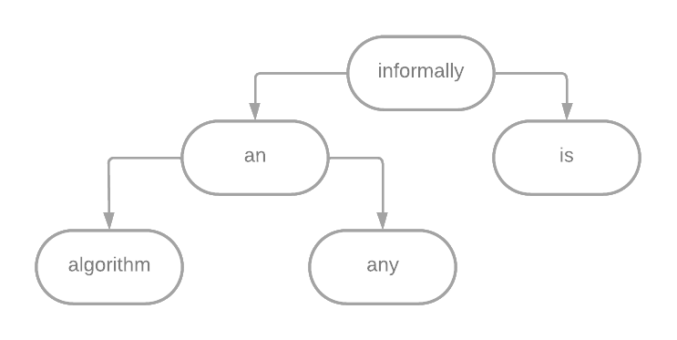

# Word Indexer
The goal of the implemented code is to index the words of a text in
alphabetical order, first in a linked list with a head node (a relatively
simple structure), and later in a binary search tree (a more complex
structure), so that the time required to index and look up words can be
compared between the two structures.
 
## Tech stack
 

 
## Running locally
 
Clone the project
 
```bash
  git clone https://github.com/Caique27/Indexador-de-Palavras.git
```
 
Go to the project directory
 
```bash
  cd Indexador-de-Palavras
```
 
Compile the file
 
```bash
  gcc ep.c -o ep
```
 
Run the program, passing the text file to be read and the structure to be used (lista or arvore) as parameters
 
```bash
  ./ep texto.txt lista
```
 
## Structures used
The linked list simply orders the elements alphabetically.
Considering the input text: "Informally, an algorithm is any", the algorithm
will create the following index:
 

 
In the binary tree, on the other hand, the algorithm places each word to be
inserted in the right branch of the initial node if the word comes
alphabetically after the node's word, or in the left branch if it comes
alphabetically before. The process repeats until a terminal branch of the
tree is reached. At that point, the new word is added and becomes a new node
of the structure.
Considering the same input as in the previous example, we get the following
structure:

Note that the order in which the words appear in the input affects the
structure, unlike the linked list.
## Analyzing a small input case
First, we will analyze the time each structure takes to index and look up a word in a short text. We will use an excerpt from the first chapter of the book Introduction to Algorithms (Cormen et al., 2009):
 
 
*"Informally, an algorithm is any well-defined computational procedure that takes some value, or
set of values, as input and produces some value, or set of values, as output. An algorithm is thus
a sequence of computational steps that transform the input into the output. We can also view an
algorithm as a tool for solving a well-specified computational problem. The statement of the
problem specifies in general terms the desired input/output relationship. The algorithm describes
a specific computational procedure for achieving that input/output relationship. For example, we
might need to sort a sequence of numbers into nondecreasing order. This problem arises
frequently in practice and provides fertile ground for introducing many standard design
techniques and analysis tools."*
 
|  Structure/Operation| `Index words`     | `Search`                                           |
| :-------- | :------- | :------------------------------------------------- |
| `Linked list`    | 0.235ms|0.057ms |
| `Binary tree`    | 0.241ms|0.053ms |
 
 
In this case, the linked list was slightly faster to build the index and
slightly slower to look up the word. However, the results are inconclusive,
since the time difference is relatively small.
 
## Large input case
Now, we will run the same analysis using a longer excerpt of text
generated by an AI, whose initial passage can be read below:
 
*"Lorem ipsum dolor sit amet, consectetur adipiscing elit. Sed ornare nisi sit amet purus aliquam,
quis dignissim quam feugiat. Aenean libero ligula, sollicitudin at placerat vitae, porta id lacus.
Aliquam ut mi eget purus laoreet vestibulum sed dignissim dolor. Etiam aliquet sem libero, nec
aliquam velit efficitur consectetur. Duis ac neque risus. Nullam efficitur est sit amet justo varius
ultricies. Nunc tempor nisl non nisl egestas posuere ac at justo. Curabitur pretium elementum
interdum.
Vivamus consequat velit et lectus vestibulum mollis. Nulla hendrerit in velit et convallis. Mauris
eget metus at metus rhoncus suscipit et sit amet arcu. Sed consequat, nisl sed convallis congue,
justo sem varius ante, ac mattis arcu mauris id ligula..."*
 
The full text has approximately 2000 words.
 
|  Structure/Operation| `Index words`     | `Search`                                           |
| :-------- | :------- | :------------------------------------------------- |
| `Linked list`    | 4.100ms|0.092ms |
| `Binary tree`    | 1.882ms|0.077ms |
 
In this case, the binary tree was slightly faster to look up the word and
considerably faster to build the index.
## Conclusion
Based on the data obtained, it is possible to conclude that searching/indexing
using a binary tree has a lower asymptotic complexity than the same
operations using the linked list. This is because, when searching for or
indexing a word in the binary tree, it is not necessary to traverse all the
nodes, even if the search is performed in the worst possible case, that is,
when the word to be searched/indexed is the last one. An example that
illustrates this explanation is the number of nodes traversed to find the
word "is" in the initial example of the report:

In the binary tree, the search starts at the word "informally" and traverses
only one node to reach the word "is".
In the linked list, on the other hand, the search starts at "algorithm" and
traverses 4 nodes until it finds "is".

 
## Contact
 
Search by username or click the icons.
 
[](https://github.com/Caique27)
[](https://www.linkedin.com/in/caique-alves-/)
